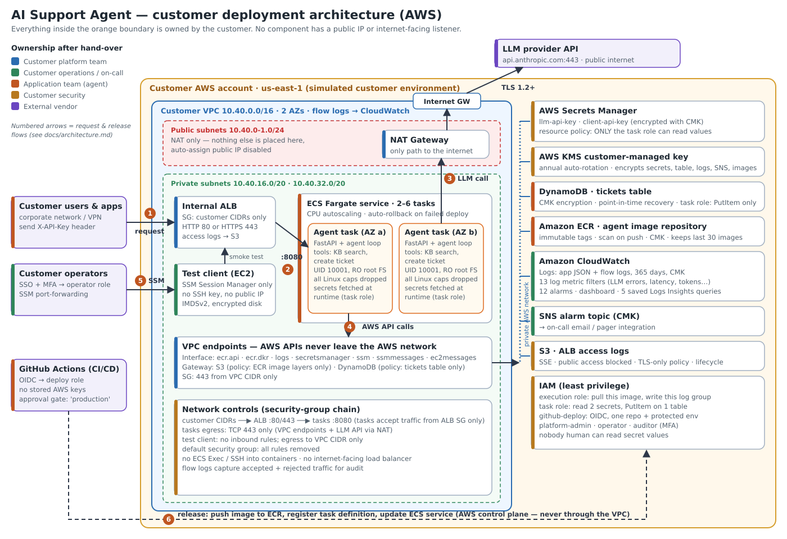

# Deploying an AI Agent into a Customer Environment (AWS)

A customer-support AI agent (Claude + tools), packaged and deployed the way a **Forward Deployed Engineer** would deliver it into a customer-controlled AWS account. It runs in a private VPC with no internet-facing endpoints, least-privilege IAM, runtime secrets, day-one monitoring, and the documentation the customer's teams need to own it.



## Deliverables

| # | Deliverable | Document | Lab requirement |
|---|---|---|---|
| 1 | Deployment architecture diagram | [docs/architecture.md](docs/architecture.md) · [SVG](docs/diagrams/architecture.svg) / [PNG](docs/diagrams/architecture.png) | 1. Deployment Architecture, 2. Customer Environment |
| 2 | IAM design document | [docs/iam-design.md](docs/iam-design.md) | 3. IAM Design |
| 3 | Security design summary | [docs/security-summary.md](docs/security-summary.md) | 4. Secrets Management (+ all security controls) |
| 4 | Operational runbook | [docs/runbook.md](docs/runbook.md) | 6. Runbook Creation |
| 5 | Knowledge transfer guide | [docs/knowledge-transfer.md](docs/knowledge-transfer.md) | 7. Knowledge Transfer |
| 6 | Reusable asset proposal | [docs/reusable-asset-proposal.md](docs/reusable-asset-proposal.md) | 8. Reusable Asset Identification |
| + | Monitoring & observability requirements | [docs/monitoring.md](docs/monitoring.md) | 5. Monitoring & Observability |
| + | Deployment evidence | [docs/evidence/](docs/evidence/README.md) | 2. Customer Environment |

## How each requirement is implemented (not just documented)

| Requirement | Implementation |
|---|---|
| Customer environment | Dedicated AWS VPC: private subnets, **internal-only ALB**, no public IPs, VPC endpoints for all AWS APIs, flow logs ([`network.tf`](infra/modules/secure-agent-platform/network.tf), [`compute.tf`](infra/modules/secure-agent-platform/compute.tf)) |
| Least-privilege IAM | 6 purpose-built roles. The agent can read **2 secrets** and **insert** tickets, nothing else. CI uses GitHub OIDC; human roles require MFA ([`iam.tf`](infra/modules/secure-agent-platform/iam.tf)) |
| Secrets management | **AWS Secrets Manager** + customer KMS key. Values are never in Terraform state, env vars, logs or shell history. A resource policy lets **only the running agent** read them. Rotation is zero-downtime, and operators rotate without ever reading values ([`data_protection.tf`](infra/modules/secure-agent-platform/data_protection.tf), [`secrets.py`](agent/app/secrets.py), [`scripts/rotate-*.sh`](scripts/)) |
| Monitoring | JSON log contract → 13 AI-specific metrics (LLM errors, latency, tokens, tool errors, rejected tools…), 12 alarms → SNS, dashboard, saved queries ([`monitoring.tf`](infra/modules/secure-agent-platform/monitoring.tf)) |
| Runbook | Install, health check, a response for every alarm, rotation, deploy/rollback, incident containment, DR, maintenance calendar, all backed by [`scripts/`](scripts/) |
| Knowledge transfer | Role-based reading paths, 8-session plan with exit criteria, how-tos, 11 hands-on exercises, FAQ, sign-off sheet |
| Reusable asset | The Terraform module + its security test suite, proposed as an org-wide "Secure Agent Platform" |

## Verification (runs without an AWS account)

| Check | Result |
|---|---|
| Agent tests (`pytest`, AWS mocked with moto) | **17 passed** |
| Security guardrail tests (`terraform test`, mocked AWS provider) | **9 / 9 passed**. They fail if, for example, the ALB becomes public, the task role gains wildcards, or an operator gains `GetSecretValue`. |
| Checkov static scan | **214 passed, 0 failed** (17 accepted findings, each justified in the code) |
| `terraform validate` / `fmt` / tflint / shellcheck / ruff | clean |
| Secret scripts end to end (set → rotate with overlap → revoke) | verified against a local Secrets Manager emulator |

CI ([`.github/workflows/ci.yml`](.github/workflows/ci.yml)) runs all of the above plus gitleaks over the full git history and a Trivy image scan.

## Quick start

**Local (no AWS, no API key):**
```bash
cd agent && docker compose up --build
curl -s localhost:8080/v1/chat -H "X-API-Key: local-dev-key-0123456789abcdef0123" \
     -H "Content-Type: application/json" -d '{"message":"how do I reset my password"}'
```

**AWS (about 30 minutes):** follow [runbook RB-INSTALL](docs/runbook.md#rb-install--first-time-installation-about-30-minutes). In short:
```bash
cd infra/bootstrap && terraform init && terraform apply                       # state bucket (once)
cd ../environments/customer-sim && cp backend.hcl.example backend.hcl && cp terraform.tfvars.example terraform.tfvars
terraform init -backend-config=backend.hcl
terraform apply -target=module.platform.aws_ecr_repository.agent              # registry first
PUSH_ONLY=1 ../../../scripts/deploy.sh v1                                     # build + push image
terraform apply -var image_tag=v1                                             # everything else
../../../scripts/set-secrets.sh && ../../../scripts/smoke-test.sh             # secrets + end-to-end test
```

**Cost:** about $0.27/hour in lab mode (NAT, endpoints, Fargate, ALB) plus LLM tokens. Run `terraform destroy` when finished (runbook §10).

## Repository layout

```
agent/                     FastAPI agent: loop, tools, Secrets Manager loader, JSON logs, tests, Dockerfile
infra/
  modules/secure-agent-platform/   reusable module (VPC, ALB, ECS, IAM, KMS, secrets, monitoring) + tests/
  environments/customer-sim/       the simulated customer environment (thin root)
  bootstrap/                       encrypted, versioned Terraform state bucket
scripts/                   status, logs, deploy, rollback, set/rotate secrets, smoke test
docs/                      the six deliverables, monitoring requirements, evidence
.github/workflows/         CI (tests + security scans) and OIDC deploy with approval gate
```

## Using your own agent

The infrastructure is agent-agnostic. To deploy a different agent, replace `agent/app/agent.py` and `agent/app/tools.py` while keeping three things: secrets via `SecretStore`, the `llm_call`/`tool_call` log events (monitoring depends on them, see [monitoring.md §2.1](docs/monitoring.md#21-application-log-contract)), and the iteration and input limits. If your tools touch new AWS resources, add narrowly scoped permissions to the task role ([KT guide §5.5](docs/knowledge-transfer.md#55-add-a-new-tool-the-change-that-needs-the-most-care)).
