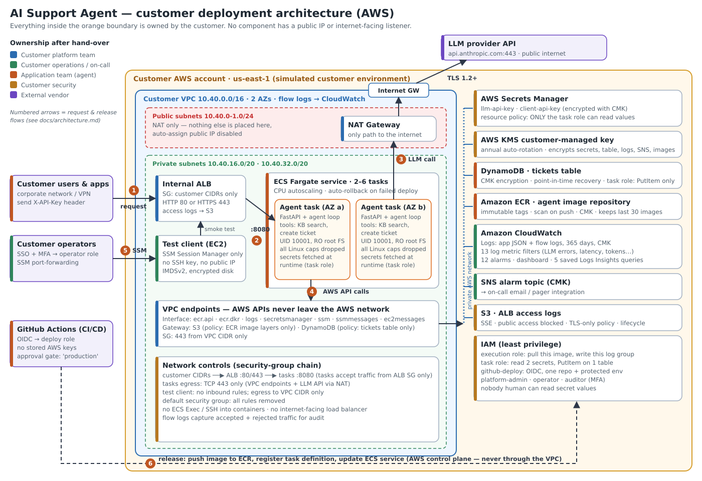
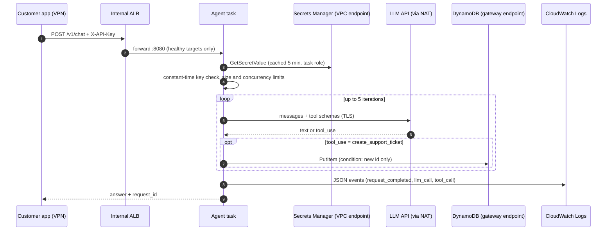

# Deployment Architecture

**Deliverable 1 of 6** · Requirement 1 (Deployment Architecture) and Requirement 2 (Customer Environment)



> PNG version: [`diagrams/architecture.png`](diagrams/architecture.png). The diagram is generated from [`diagrams/make_diagram.py`](diagrams/make_diagram.py), so it can be regenerated when the architecture changes.

---

## 1. What is being deployed

A **customer-support AI agent**: an HTTP API that answers questions about the customer's product. For each request it runs a short agent loop. Claude decides whether to call one of two tools:

| Tool | What it does | Side effects |
|---|---|---|
| `search_knowledge_base` | Keyword search over help-center articles bundled in the image | None (read-only, in-process) |
| `create_support_ticket` | Opens a ticket for a human agent | Inserts **one** item into DynamoDB. Cannot read, update or delete. |

The agent runs inside a **simulated customer environment**: a dedicated AWS account and VPC that is treated exactly like a customer's, with the same constraints. There is no public ingress, all keys belong to the customer, every human role requires MFA, and the operating team has no shell access to production containers.

## 2. Environment constraints (treated as real)

| # | Customer constraint | How the design satisfies it |
|---|---|---|
| C-1 | No internet-facing endpoints | The ALB is `internal = true`; nothing has a public IP (asserted by `terraform test`). |
| C-2 | Customer data stays in the customer account | Tickets, logs and secrets all live in the customer's account, encrypted with the customer's KMS key. Only the prompt text goes to the LLM vendor (see [security summary](security-summary.md) §5). |
| C-3 | AWS API traffic must not traverse the internet | VPC endpoints for ECR, CloudWatch Logs, Secrets Manager, SSM, S3 and DynamoDB. |
| C-4 | Only approved outbound destinations | Task egress is TCP 443 only. The NAT gateway is the single path to the internet, used for the LLM API. Domain-level filtering is the recommended production upgrade (residual risk R-1). |
| C-5 | No long-lived credentials | Workloads use IAM roles. CI uses GitHub OIDC. There are no access keys anywhere. |
| C-6 | Secrets readable only by the workload | A Secrets Manager resource policy denies `GetSecretValue` to every principal except the agent task role. |
| C-7 | Customer staff operate it, not the vendor | Three human roles (admin, operator, auditor), a runbook, and a knowledge-transfer plan with sign-off. |
| C-8 | Changes are auditable and reversible | Everything is Terraform. Image tags are immutable. Deploys are approval-gated and auto-roll back on failure. |

## 3. Components

| Layer | Component | Key settings | Terraform |
|---|---|---|---|
| Network | VPC `10.40.0.0/16`, 2 AZs | DNS on; default SG emptied; flow logs `ALL` | `network.tf` |
| | Public subnets (/24 ×2) | NAT gateway only; no auto public IP | `network.tf` |
| | Private subnets (/20 ×2) | ALB, tasks, endpoints, test client | `network.tf` |
| | NAT gateway | 1 in lab mode, 1 per AZ in production | `network.tf` |
| | VPC endpoints | 7 interface + 2 gateway (with restrictive endpoint policies) | `network.tf` |
| Ingress | Internal ALB | SG allows customer CIDRs only; drops invalid headers; access logs to S3; HTTPS when an ACM cert is given | `compute.tf` |
| Compute | ECS Fargate service | 2–6 tasks (CPU target 60%); circuit-breaker rollback; ECS Exec disabled | `compute.tf` |
| | Container | Python 3.12 slim, UID 10001, read-only root FS, all capabilities dropped, health check | `agent/Dockerfile`, `compute.tf` |
| Data | DynamoDB `tickets` | On-demand; KMS CMK; PITR; deletion protection outside lab mode | `data_protection.tf` |
| Secrets | Secrets Manager ×2 | CMK; resource policy; values set out-of-band (never in Terraform state) | `data_protection.tf` |
| Keys | KMS CMK | Annual rotation; scoped service grants (Logs, CloudWatch→SNS) | `data_protection.tf` |
| Images | ECR | Immutable tags; scan on push; CMK; keeps 30 images | `data_protection.tf` |
| Observability | CloudWatch Logs, metric filters, alarms, dashboard, saved queries; SNS | See [monitoring.md](monitoring.md) | `monitoring.tf` |
| Access | IAM roles ×6 (+ flow-logs + test-client roles) | See [iam-design.md](iam-design.md) | `iam.tf` |
| Test access | Private EC2 test client | SSM-only, IMDSv2, encrypted disk; stands in for a customer user inside the network | `compute.tf` |

## 4. Network boundaries and trust zones

```
 Zone 0  Internet ............ LLM provider API only (outbound HTTPS via NAT). No inbound path exists.
 Zone 1  Customer network .... users / apps (VPN, Direct Connect or peered VPCs) -> allowed_client_cidrs
 Zone 2  VPC private subnets .. ALB (SG: Zone 1 CIDRs) -> tasks (SG: ALB only) -> endpoints (SG: VPC CIDR)
 Zone 3  AWS managed services . reached only through VPC endpoints, scoped by IAM + endpoint policies
 Zone 4  Control plane ........ Terraform (platform admin), GitHub OIDC deploys, operators via SSO + MFA
```

**Security-group chain:** `client CIDRs → ALB:80/443 → tasks:8080 → egress 443`. Each hop names the previous hop's security group, not a CIDR, so a new resource in the VPC cannot reach the tasks by accident.

## 5. Request and release flows (numbered arrows)



| # | Flow | Path | Controls |
|---|---|---|---|
| 1 | Chat request | Customer network → internal ALB | SG allow-list; API key; 4,000-character limit |
| 2 | Forward | ALB → task :8080 | Task SG accepts the ALB SG only; health checks on `/health` |
| 3 | LLM call | Task → NAT → IGW → LLM API | TLS; 443-only egress; 30 s timeout; max 5 tool iterations |
| 4 | AWS API calls | Task → VPC endpoints → Secrets Manager / DynamoDB / Logs | IAM task role + endpoint policies |
| 5 | Operator access | Laptop → SSM → test client → ALB | SSO + MFA; `ssm:StartSession` on one instance; sessions logged in CloudTrail |
| 6 | Release | GitHub Actions → ECR / ECS APIs (AWS control plane) | OIDC to one repo plus a protected environment; image scan gate; circuit breaker |

## 6. Operational ownership

**R** = responsible (does it), **A** = accountable (decides and signs off), **C** = consulted, **I** = informed.

| Area | Customer platform team | Customer ops / on-call | Application team | Customer security | FDE (us, until hand-over) |
|---|---|---|---|---|---|
| VPC, NAT, endpoints, Terraform state | **A/R** | I | I | C | R (build) |
| IAM roles and SSO mapping | **A/R** | I | I | C | R (build) |
| KMS key and secrets containers | R | I | I | **A** | R (build) |
| Secret values and rotation | C | **R** | I | **A** | – |
| Releases (deploy / rollback) | I | R | **A/R** | I | R (until sign-off) |
| Alarms, on-call response | I | **A/R** | C | I | C (hypercare 2 weeks) |
| Prompt, tools, model choice | I | I | **A/R** | C | C |
| LLM vendor account and billing | C | I | R | C | – (customer contract) |
| Security reviews, audit evidence | C | I | C | **A/R** | C |

## 7. Availability, scaling and capacity

* **HA:** two AZs. The minimum of 2 tasks is spread across AZs by Fargate, and the ALB health-checks every 15 s.
* **Scaling:** target tracking at 60% CPU, from 2 to 6 tasks. Each task caps concurrent chats at 20 (HTTP 429 beyond that), which protects the LLM rate limit and memory.
* **Deploys:** rolling, 100% minimum / 200% maximum. A failed health check triggers automatic rollback.
* **Dependencies:** the LLM API is the main external dependency. Its failure returns HTTP 502 with a clean message, and alarm `P1-llm-errors` fires (runbook RB-03).
* **Targets (proposed SLOs):** 99.5% monthly availability of `/v1/chat`, p95 latency under 20 s. See [monitoring.md](monitoring.md).

## 8. Key design decisions

| Decision | Chosen | Alternatives considered | Why |
|---|---|---|---|
| Compute | ECS Fargate | EKS, Lambda, EC2 | No nodes to patch, which suits a customer ops team without Kubernetes skills. Lambda's 15-minute limit and cold starts are awkward for agent loops. |
| Ingress | Internal ALB | API Gateway private endpoint | Simple health checks and access logs; long-running requests (idle timeout 120 s). |
| Secret delivery | App fetches at runtime (task role) with a 5-minute cache | ECS `secrets` injection as env vars | Rotation without a restart; secrets never in environment variables or the task definition. |
| Client auth | API key in Secrets Manager with stage-based rotation | mTLS, Cognito/OIDC JWT | Lowest integration cost for the customer's internal apps. **Production upgrade:** the customer IdP (OIDC) on the ALB (R-3). |
| AWS API access | VPC endpoints plus NAT | NAT only | Keeps AWS traffic private, and endpoint policies block data exfiltration to other buckets and tables. |
| Infra delivery | One reusable Terraform module plus a thin environment root | Console, CDK | Reviewable, testable (`terraform test`), and reusable for the next customer ([reusable-asset-proposal.md](reusable-asset-proposal.md)). |

## 9. Approximate running cost (us-east-1, lab mode)

| Item | ~USD/hour | ~USD/month |
|---|---|---|
| NAT gateway (1) | 0.045 | 33 |
| Interface endpoints (7 × 2 AZs) | 0.14 | 102 |
| Fargate (2 × 0.5 vCPU / 1 GB) | 0.05 | 36 |
| Internal ALB | 0.023 | 17 |
| Test client t3.micro | 0.010 | 8 |
| KMS, Secrets, alarms, dashboard, logs | – | ~8 |
| **Total (before LLM usage)** | **≈ 0.27** | **≈ 205** |

These are list prices at the time of writing; check the AWS Pricing Calculator for current rates. For a lab, deploy, collect evidence, and run `terraform destroy` the same day (about $3–6). LLM token cost is separate and capped by the `P2-token-budget` alarm.
